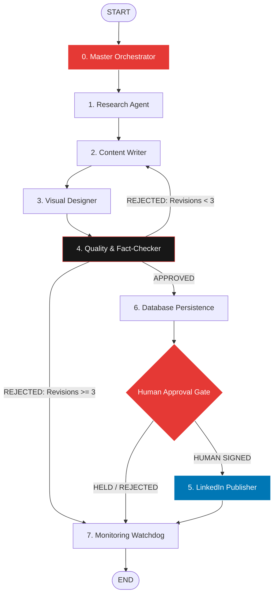

# LinkedIn AgentOS — Eight-Agent Architecture & LangGraph Specification

## Overview
LinkedIn AgentOS employs an asynchronous 8-agent swarm built on **LangGraph**. A single Master Orchestrator coordinates seven specialist agents, ensuring separation of concerns, deterministic durability, and human-in-the-loop control.

---

## 1. Agent Responsibility Matrix

### Agent 0 — Master Orchestrator (`master`)
- **System Role**: Central DAG Planner & Controller.
- **Inputs**: High-level task objective, topic, target audience, schedule.
- **Outputs**: Decomposed specialist tasks, execution plan, routing decisions.
- **Rule**: Never generates raw content or calls external media tools directly.

### Agent 1 — Research Specialist (`research`)
- **System Role**: Technical Discovery & Trend Extraction.
- **Inputs**: Topic, technical category.
- **Outputs**: Verified summaries, primary source URLs, key architectural findings.
- **Tools**: Web Search MCP, Article Extraction MCP.

### Agent 2 — Content Writer Specialist (`writer`)
- **System Role**: High-Signal Technical Copywriting.
- **Inputs**: Research findings, target audience, quality feedback.
- **Outputs**: Opening hook, body paragraphs, closing CTA, hashtags, SHA-256 fingerprint.
- **Rule**: Avoids generic AI clichés and guarantees technical depth.

### Agent 3 — Visual Designer Specialist (`designer`)
- **System Role**: Visual Architecture & Diagramming.
- **Inputs**: Content draft, architectural patterns.
- **Outputs**: Mermaid flowcharts, SVGs, multi-slide PDF carousels, Cloudinary URLs.
- **Tools**: Mermaid CLI, Pillow, ReportLab, Cloudinary Storage.

### Agent 4 — Quality & Fact-Checker (`quality`)
- **System Role**: Factual Verification & Quality Gatekeeper.
- **Inputs**: Content draft, research sources, media asset.
- **Outputs**: Structured scorecard (accuracy, readability, originality), issue list, APPROVE/REJECT.
- **Rule**: A high readability score never overrides a factual error.

### Agent 5 — LinkedIn Publishing Specialist (`publisher`)
- **System Role**: Official OAuth 2.0 Integration & Asset Upload.
- **Inputs**: Approved content version, cryptographic approval signature.
- **Outputs**: LinkedIn post URN, public post URL, publication audit record.
- **HARD GATE**: Will refuse to publish if human approval signature does not match content checksum.

### Agent 6 — Database & Persistence Specialist (`database`)
- **System Role**: ACID Integrity & Read-Back Verification.
- **Inputs**: Task and draft payloads.
- **Outputs**: Immediate read-back confirmation against Neon PostgreSQL.
- **Rule**: Every create and update must be read back and verified before workflow continues.

### Agent 7 — Monitoring & System Health Specialist (`monitoring`)
- **System Role**: Watchdog, Telemetry, and Controlled Retries.
- **Inputs**: DAG execution history, step latencies.
- **Outputs**: Health audits, failure diagnostics, safe exponential backoff retries (capped at 3).

---

## 2. LangGraph State Machine Graph

